# Commande à table par QR code — deux restaurants de démonstration

**14 rue du Gros-Horloge, 76000 Rouen** — ouvert tous les jours, 12h–14h30 et 19h–22h30. Un lieu, deux comptoirs : Le QRamen (bar a ramen) et QRoque Monsieur (croque-monsieur).

Deux restaurants fictifs construits pour un exercice de formation, poussés bien au-delà de la
consigne : le client scanne le QR code de sa table, commande depuis son téléphone, la cuisine voit
le ticket arriver, et le ticket (puis l'addition) part en PDF **tout seul**.

| Restaurant | Concept | En ligne |
| --- | --- | --- |
| **Le QRamen** | bar à ramen, Rouen | <https://qramen.alexisld.fr/menu.html?table=T05> |
| **QRoque Monsieur** | bistrot du croque, Rouen | <https://qroque.alexisld.fr/menu.html?table=T05> |

Écran cuisine (le même pour les deux) : <https://qramen.alexisld.fr/cuisine.html> · Vue salle : <https://qramen.alexisld.fr/salle.html>

## Aperçu

### Chevalet de table

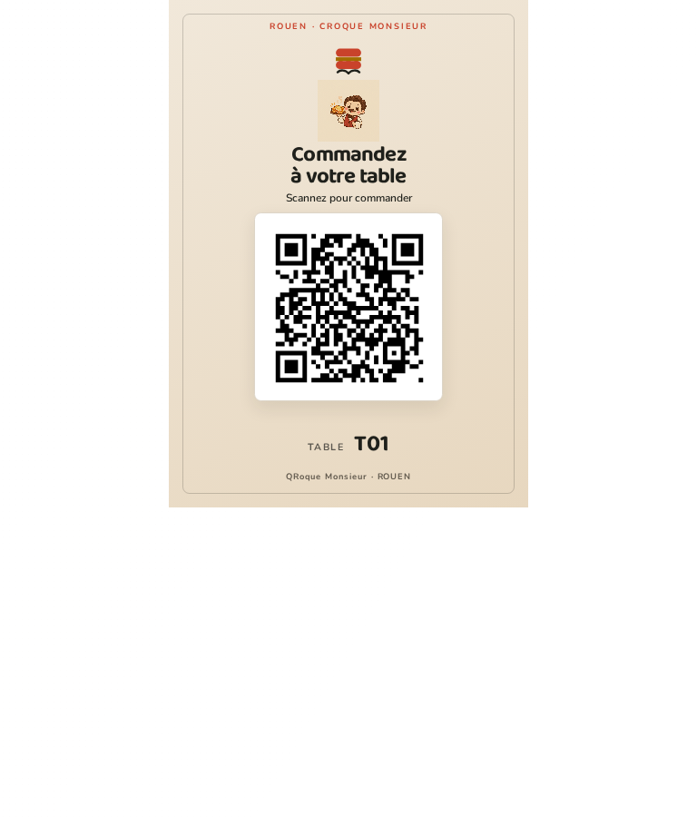

Le générateur propose le format A4 (quatre chevalets par feuille) et le format Comptoir (un chevalet A5 centré sur une feuille A4). Le QR mesure 45 mm en A4 et 62 mm au comptoir.

### Menu sur téléphone

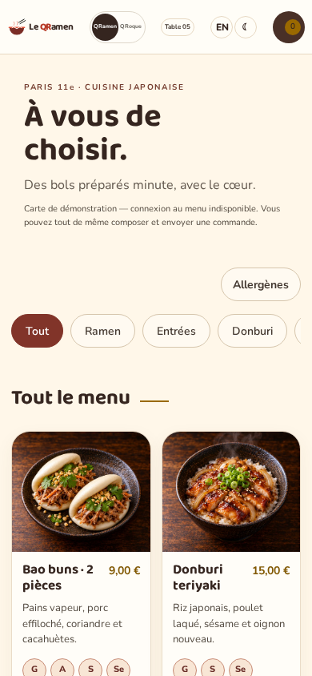

La carte QRamen présente ses catégories et ses plats avec leurs vraies photos.

### Écran cuisine

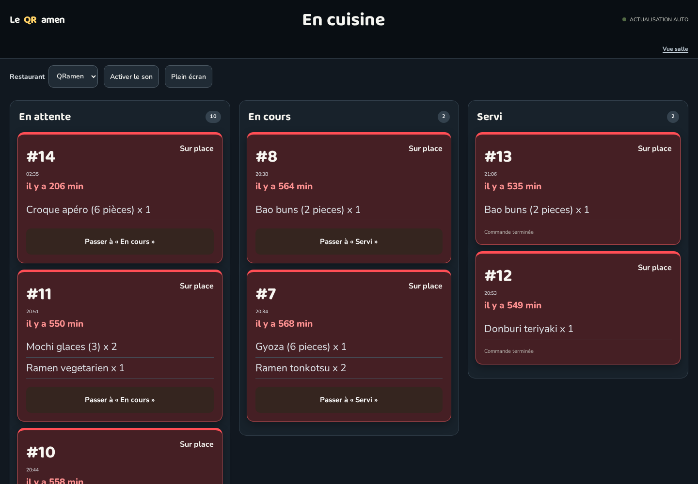

Le tableau regroupe les commandes en attente, en cours et servies.

### Ticket de cuisine

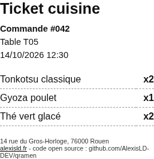

Le bon imprimé indique la table, les plats commandés et leurs quantités.

### Accueil QRamen

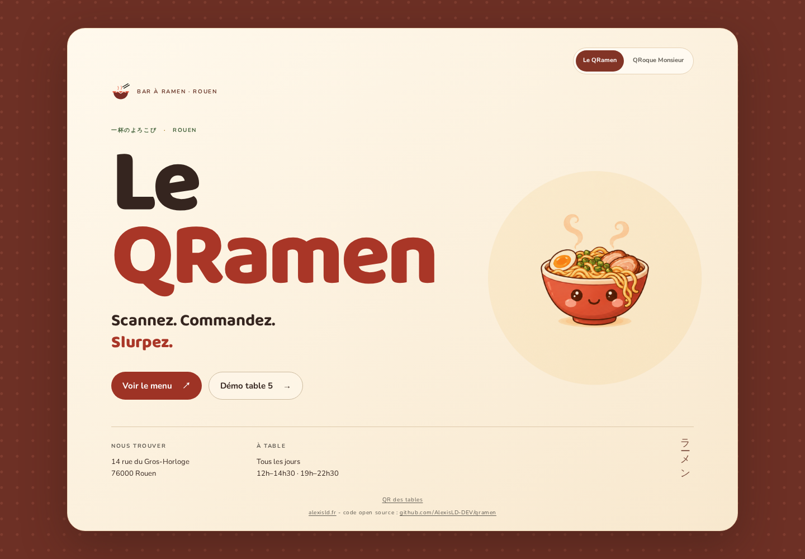

La page d’accueil présente le restaurant Le QRamen.

### Accueil QRoque

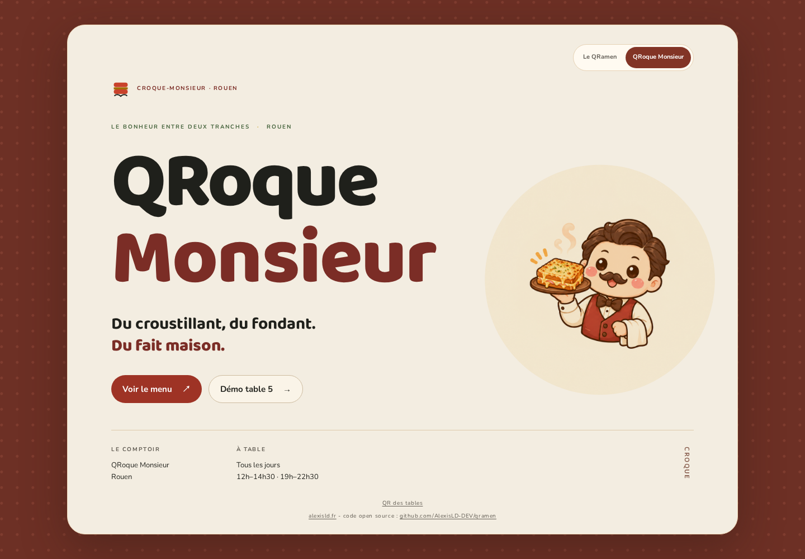

La page d’accueil présente le restaurant QRoque Monsieur.

### QR des tables

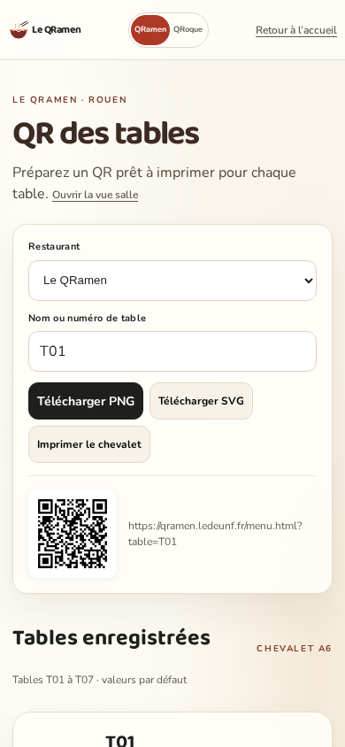

La page `/qr.html` permet de générer et d’imprimer les QR codes des tables.

### Carte QRoque sur téléphone

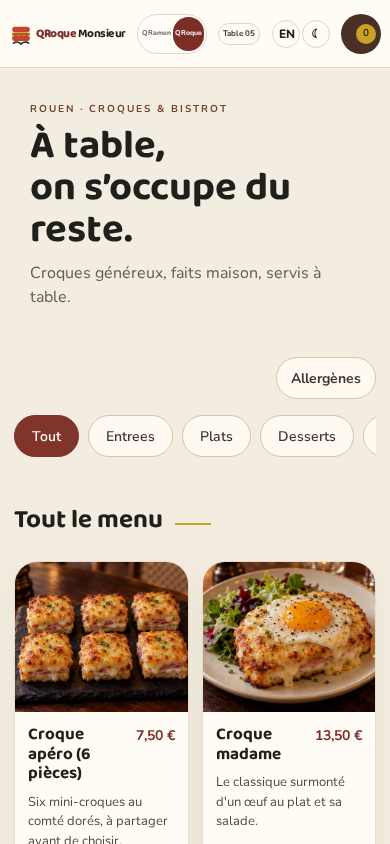

La carte QRoque présente les croques et leurs photos sur téléphone.

**À imprimer — un PDF combiné par restaurant**

- Le QRamen, formats A4 et Comptoir : [`public/assets/chevalets-qramen.pdf`](public/assets/chevalets-qramen.pdf)
- QRoque Monsieur, formats A4 et Comptoir : [`public/assets/chevalets-qroque.pdf`](public/assets/chevalets-qroque.pdf)

Chaque PDF présente d’abord les feuilles A4 (quatre cartes par feuille, repères pointillés), puis les pages Comptoir A5. Le QR mesure 45 mm en A4 et 62 mm au Comptoir, avec une zone de silence conservée autour du code.

## Comment ça marche

```
        scan du QR de la table
Client ───────────────────────► page statique (HTML/CSS/JS, sans framework)
   ▲                                   │
   │                                   ▼
   │                          API Worker Cloudflare
                 (n8n en secours)
   │                     /menu /commande /statut /cuisine
   │                                   │
   └────────── Airtable ◄──────────────┘
        (Tables, Plats, Commandes, Lignes)
                     │
                     ▼
        service PDF local (Chrome headless)
        → ticket cuisine + addition, rangés dans Airtable
```

- **Cloudflare Worker** porte les routes du menu, des commandes, du suivi, de la cuisine et de la salle ; le site essaie n8n en secours. Les workflows n8n versionnés continuent notamment de porter les tâches PDF.
- **Airtable** porte les données : 7 tables, 16 plats, commandes et lignes, avec les pièces jointes
  (ticket, addition) et un statut.
- **Le service PDF** (`outils/pdf-service.py`) transforme un HTML en PDF via Chrome headless ; il est
  protégé par un jeton partagé et n'écoute que pour la machine.
- **Cloudflare Pages** sert `qramen.alexisld.fr` et `qroque.alexisld.fr` ; les anciens hôtes redirigent en 301.

## Deux cartes, un seul moteur

| Carte | Ce qu'elle sert |
|---|---|
| **Le QRamen** | 8 plats asiatiques (ramen tonkotsu, shoyu, végétarien, gyoza, donburi, bao, karaage, mochi) |
| **Le QRoque-Monsieur** | les 8 plats **de l'énoncé** : soupe à l'oignon, salade de chèvre chaud, entrecôte frites, magret, risotto, crème brûlée, fondant, cidre |

Un champ `Concept` dans la base suffit : `GET /menu?concept=QRamen` ou `?concept=QRoque`. Le champ multi-sélection `Allergenes` porte les 14 familles réglementaires ; les instructions de mise à jour figurent dans le [mode opératoire](docs/mode-operatoire-restaurateur.md). Les mêmes
workflows servent les deux restaurants. Tous les visuels de plats ont été générés pour le projet
(16 photos, style reportage, aucun texte incrusté).

## Mockups « en situation »

Le QR incrusté est un **vrai** QR code (il se décode vers la page du menu), pas une illustration.

| Chevalet de table | Vitrine |
| --- | --- |
| 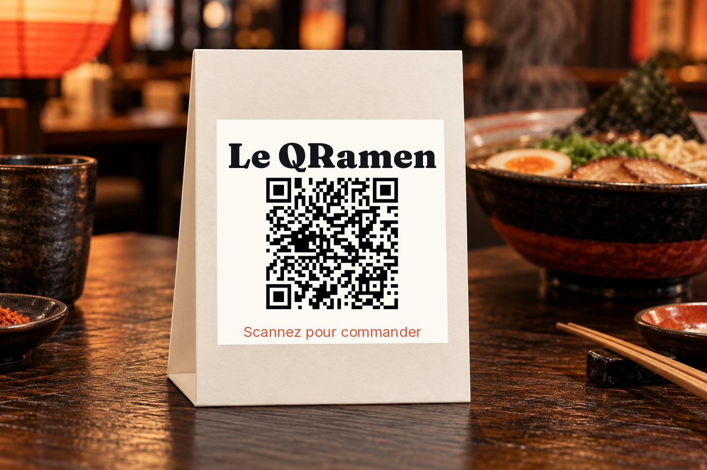 | 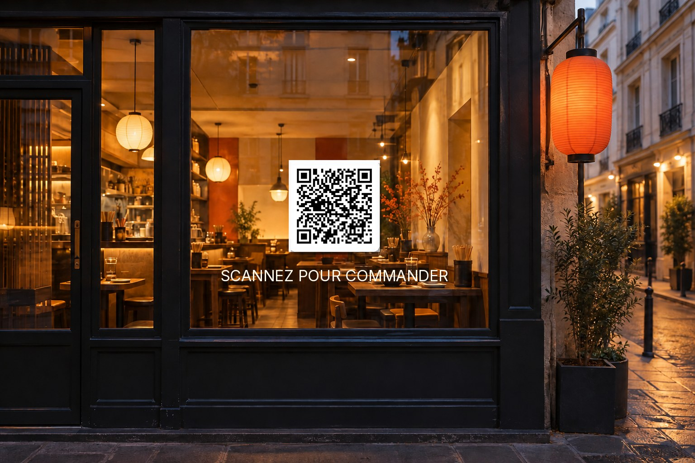 |

Scènes complémentaires (QR incrusté + vraie page dans l'écran du téléphone) :

| Comptoir du bar | Terrasse, version brasserie |
| --- | --- |
| 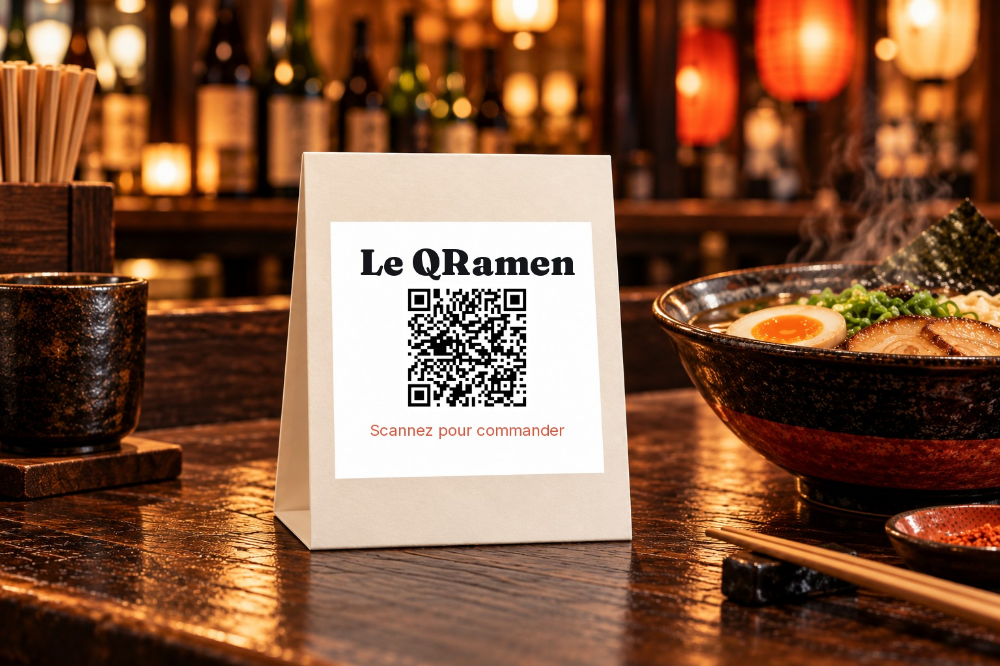 | 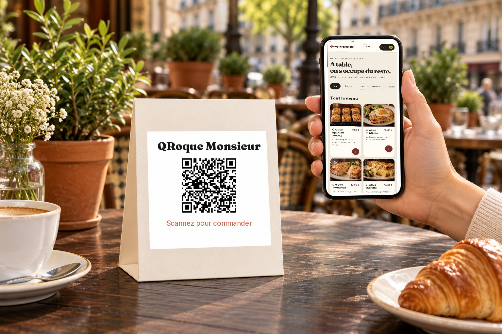 |

## Gérer les QR des tables

Depuis l’accueil, le lien discret **QR des tables** ouvre `/qr.html`. La page liste les tables disponibles, propose l’aperçu A4 ou Comptoir, puis imprime l’ensemble dans un PDF unique. Le générateur fonctionne côté navigateur avec la bibliothèque locale `public/assets/vendor/qrcode.js`, sans CDN ni service de QR externe. Les QR ciblent le domaine public propre au restaurant.

Guide détaillé : [mode opératoire restaurateur](docs/mode-operatoire-restaurateur.md).

## Reproduire

```bash
# base Airtable : tables Tables, Plats, Commandes, Lignes + champs Concept/Description/Photo/Allergenes/Etat
python3 outils/workflows.py            # génère les workflows n8n (dans etat/, non versionné)
bash outils/publier-workflows.sh       # importe, publie et redémarre n8n
bash outils/mettre-en-ligne.sh         # service systemd + site Caddy

# service PDF (jeton dans ~/.hermes/.secrets/qramen-pdf.key, jamais dans le dépôt)
systemctl --user start qramen-pdf
```

## English summary

A fictional ramen bar (Rouen) built for a training exercise, taken far beyond the brief: scan the QR
code on your table, order from your phone, the kitchen board updates live, and the kitchen ticket is
generated as a PDF and attached to the order automatically. Automation runs on self-hosted **n8n**,
data lives in **Airtable**, the pages are plain HTML/CSS/JS, and PDFs are rendered by a small local
service around headless Chrome. A single `Concept` field lets the same engine serve two menus — the
ramen one, and the French brasserie one taken from the exercise brief.

## Licence & sécurité

- Code sous licence [MIT](LICENSE).
- Aucun secret dans le dépôt : le jeton Airtable reste dans n8n, la clé du service PDF dans
  `~/.hermes/.secrets/`. Voir [SECURITY.md](SECURITY.md).
- Code open source, signature « alexisld.fr » présente en pied de page du site.
