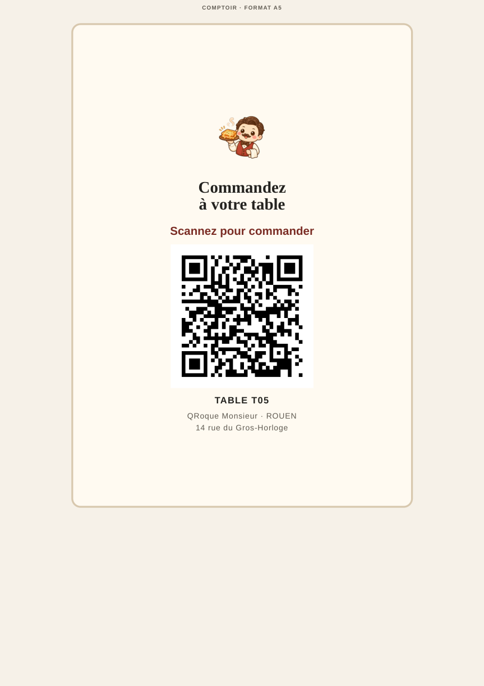
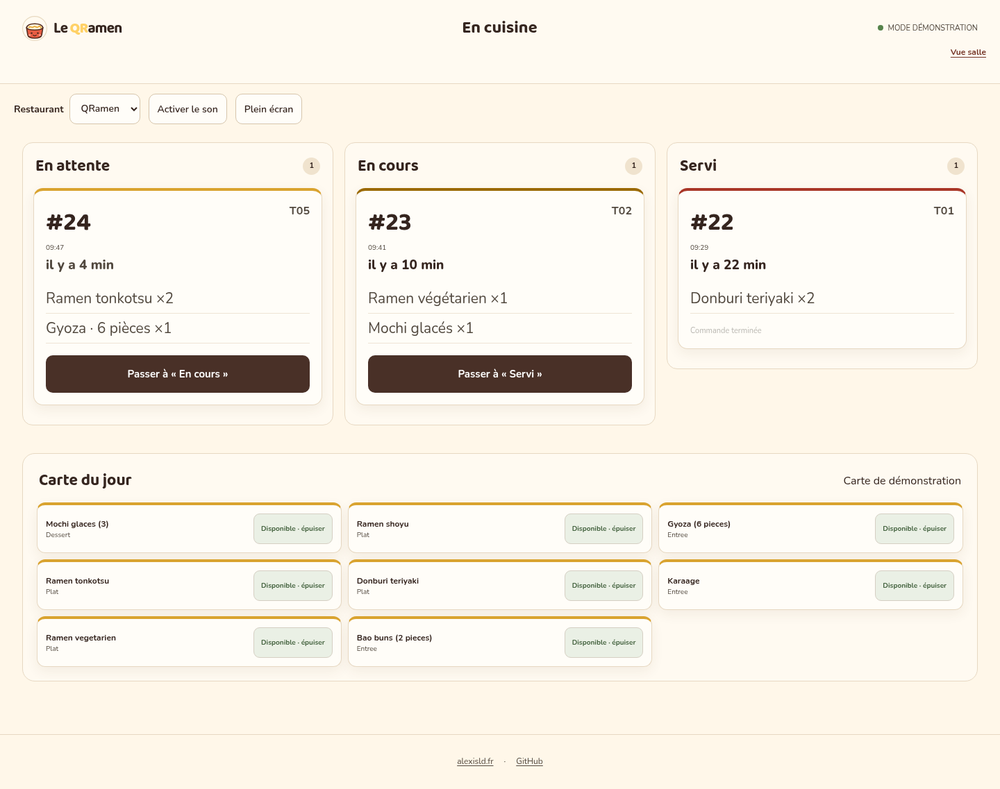
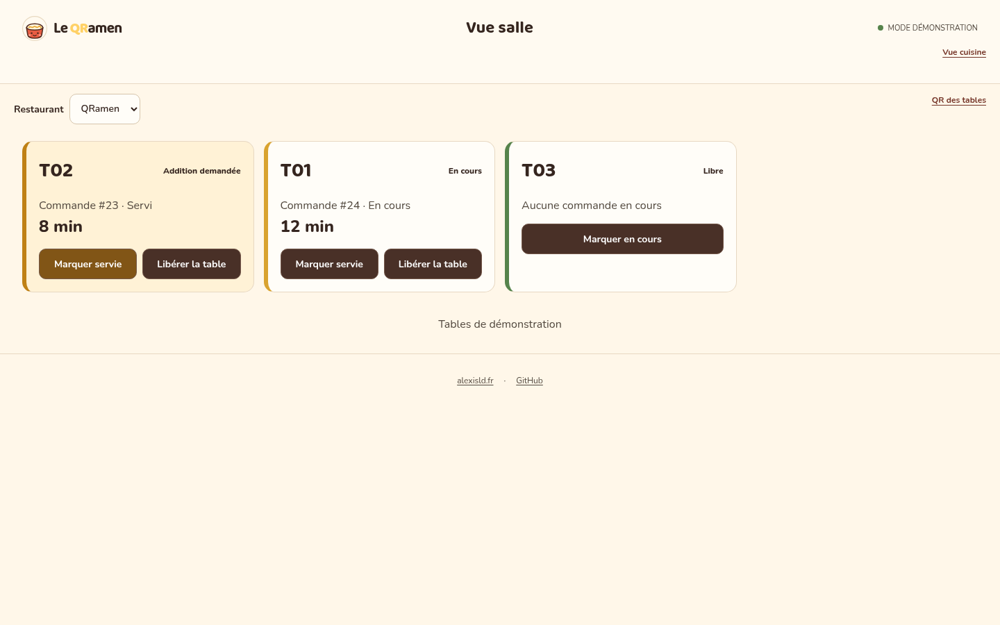

# QRamen & QRoque — commande à table par QR code

Deux sites de démonstration pour un parcours de commande en restaurant : le client scanne le QR de sa table, consulte la carte et envoie sa commande; l’équipe la suit depuis les écrans cuisine et salle.

## Contexte

Ce projet est un exercice réalisé dans le cadre de la formation « Product Builder » de DataSuits (No-Code & IA), donné par le formateur Rachid Lghachi. Les enseignes, les cartes, les prix et les commandes sont fictifs et servent de données de démonstration.

**Sites :** [qramen.alexisld.fr](https://qramen.alexisld.fr) · [qroque.alexisld.fr](https://qroque.alexisld.fr) · [alexisld.fr](https://alexisld.fr)

## Aperçu

### Accueils

| QRamen | QRoque Monsieur |
| --- | --- |
|  |  |

### Chevalet A5 — table T05

Exemple de page A5 centrée sur une feuille A4, générée depuis `/qr` pour la table T05. Le site était en thème sombre pendant la vérification; le PDF reste en thème clair.



Les PDF complets comprennent une page A4 par table, puis une page A5 par table, de T01 à T07 : [QRamen](public/assets/chevalets-qramen.pdf) · [QRoque](public/assets/chevalets-qroque.pdf). Aperçus : [QRamen A4](docs/preuves-github-pdf/qramen-a4-t01.png) · [QRamen A5](docs/preuves-github-pdf/qramen-a5-t05.png) · [QRoque A4](docs/preuves-github-pdf/qroque-a4-t01.png) · [QRoque A5](docs/preuves-github-pdf/qroque-a5-t05.png). Le générateur `/qr` a aussi été imprimé en mode sombre : [A4 QRamen](docs/preuves-github-pdf/qr-page-a4-dark-mode.png) · [A5 QRoque T05](docs/preuves-github-pdf/qr-page-a5-t05-dark-mode.png).

### Menus

| QRamen | QRoque Monsieur |
| --- | --- |
|  |  |

### Cuisine



### Salle



### QR des tables


## Fonctionnalités

- Deux cartes et deux parcours clients, adaptés au QRamen et à QRoque Monsieur.
- Identification de la table dans l’URL du QR, panier et envoi de commande.
- Écrans cuisine et salle pour consulter et suivre les commandes.
- Génération dans le navigateur des QR de table et des chevalets PDF A4 ou A5.
- Tickets de cuisine et additions produits sous forme de PDF par le service dédié.

## Stack et architecture

Les interfaces sont des pages HTML, CSS et JavaScript sans framework. **Cloudflare Pages** sert les sites statiques; un **Cloudflare Worker** fournit l’API du menu, des commandes et du suivi. Les workflows **n8n** assurent l’automatisation et peuvent servir de relais selon la route. **Airtable** stocke les tables, plats, commandes et lignes de commande. Un service local autour de Chrome headless produit les tickets et additions PDF.

```text
Navigateur → Cloudflare Pages → Cloudflare Worker → Airtable
                                  ↕
                            workflows n8n
                                  ↓
                         service PDF local
```

## Installation et développement

Le dépôt contient les pages statiques, le Worker, les workflows générables et les scripts d’exploitation. Le déploiement complet dépend d’une base Airtable, d’un compte Cloudflare et d’une instance n8n configurés séparément.

```bash
# Préparer/générer les workflows n8n
python3 outils/workflows.py

# Déployer le Worker depuis son dossier (après configuration locale)
cd worker
npx wrangler deploy
```

Les scripts `outils/mettre-en-ligne.sh` et `outils/publier-workflows.sh` correspondent au déploiement auto-hébergé de l’environnement d’origine. Les identifiants et secrets sont à fournir dans la configuration locale; ils ne sont pas inclus dans ce dépôt. Les étapes destinées à l’équipe du restaurant sont décrites dans le [mode opératoire](docs/mode-operatoire-restaurateur.md).

## Licence et mentions

Le code est distribué sous licence [MIT](LICENSE). Les contenus de démonstration et les établissements représentés sont fictifs; les pages publiques servent de démonstration du projet. Les captures et images présentes dans ce dépôt sont versionnées avec le code. Aucun secret ou jeton d’accès n’est requis pour consulter le dépôt. Voir [SECURITY.md](SECURITY.md) pour le signalement de vulnérabilités.

---

## English

# QRamen & QRoque — QR table ordering

Two demonstration websites for restaurant ordering: guests scan their table QR code, browse the menu and submit an order; staff follow it on the kitchen and dining room screens.

## About this exercise

This project is an exercise completed as part of DataSuits’ “Product Builder” training (No-Code & AI), assigned by trainer Rachid Lghachi. The restaurant brands, menus, prices and orders are fictional demonstration data.

**Websites:** [qramen.alexisld.fr](https://qramen.alexisld.fr) · [qroque.alexisld.fr](https://qroque.alexisld.fr) · [alexisld.fr](https://alexisld.fr)

## Overview

### Home pages

| QRamen | QRoque Monsieur |
| --- | --- |
|  |  |

### A5 table stand — table T05

Example of an A5 page centred on A4 paper, generated from `/qr` for table T05. The website was in dark mode during verification; the PDF remains in light mode.


The complete PDFs contain one A4 page per table, followed by one A5 page per table, from T01 to T07: [QRamen](public/assets/chevalets-qramen.pdf) · [QRoque](public/assets/chevalets-qroque.pdf). Previews: [QRamen A4](docs/preuves-github-pdf/qramen-a4-t01.png) · [QRamen A5](docs/preuves-github-pdf/qramen-a5-t05.png) · [QRoque A4](docs/preuves-github-pdf/qroque-a4-t01.png) · [QRoque A5](docs/preuves-github-pdf/qroque-a5-t05.png). The `/qr` generator was also printed in dark mode: [QRamen A4](docs/preuves-github-pdf/qr-page-a4-dark-mode.png) · [QRoque A5 T05](docs/preuves-github-pdf/qr-page-a5-t05-dark-mode.png).

### Menus

| QRamen | QRoque Monsieur |
| --- | --- |
|  |  |

### Kitchen


### Dining room


### Table QR codes


## Features

- Two menus and guest flows for QRamen and QRoque Monsieur.
- Table identification in the QR URL, a cart and order submission.
- Kitchen and dining room screens to view and track orders.
- Browser-based table QR generation and A4 or A5 stand PDFs.
- Kitchen tickets and bills generated as PDFs by a dedicated service.

## Stack and architecture

The interfaces are plain HTML, CSS and JavaScript, with no framework. **Cloudflare Pages** serves the static sites; a **Cloudflare Worker** provides the menu, order and tracking API. **n8n** workflows handle automation and can act as a fallback for selected routes. **Airtable** stores tables, dishes, orders and order lines. A local service built around headless Chrome generates PDF tickets and bills.

```text
Browser → Cloudflare Pages → Cloudflare Worker → Airtable
                                  ↕
                             n8n workflows
                                  ↓
                          local PDF service
```

## Setup and development

The repository contains the static pages, Worker, generated workflow source and operations scripts. A full deployment requires a separately configured Airtable base, Cloudflare account and n8n instance.

```bash
# Prepare/generate n8n workflows
python3 outils/workflows.py

# Deploy the Worker from its directory (after local configuration)
cd worker
npx wrangler deploy
```

The `outils/mettre-en-ligne.sh` and `outils/publier-workflows.sh` scripts target the original self-hosted environment. Supply credentials and secrets through local configuration; they are not stored in this repository. Restaurant staff instructions are in the [operating guide](docs/mode-operatoire-restaurateur.md).

## Licence and notices

The code is distributed under the [MIT License](LICENSE). The demonstration content and venues are fictional; the public websites demonstrate the project. Screenshots and images are versioned in this repository. No secret or access token is required to view the repository. See [SECURITY.md](SECURITY.md) for vulnerability reporting.
