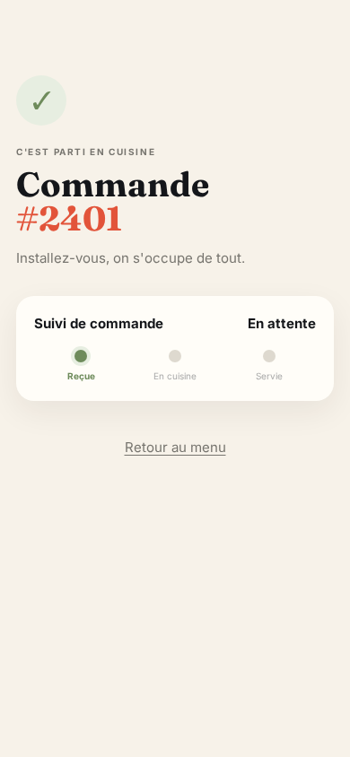
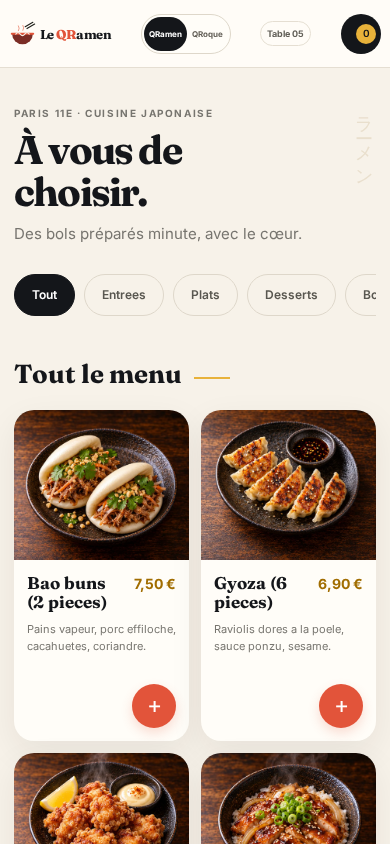
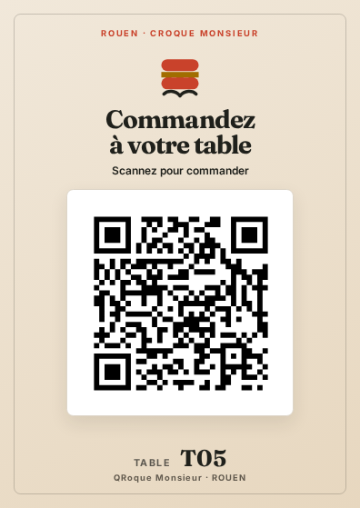
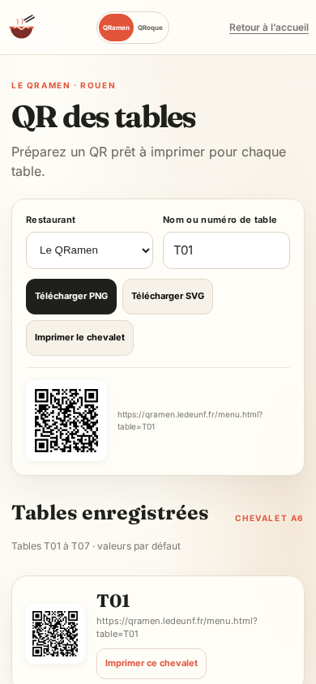
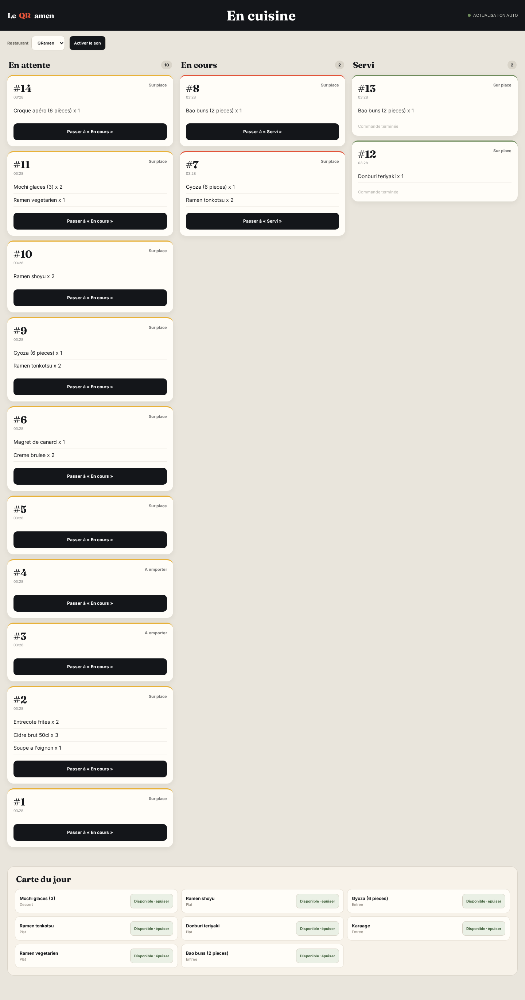
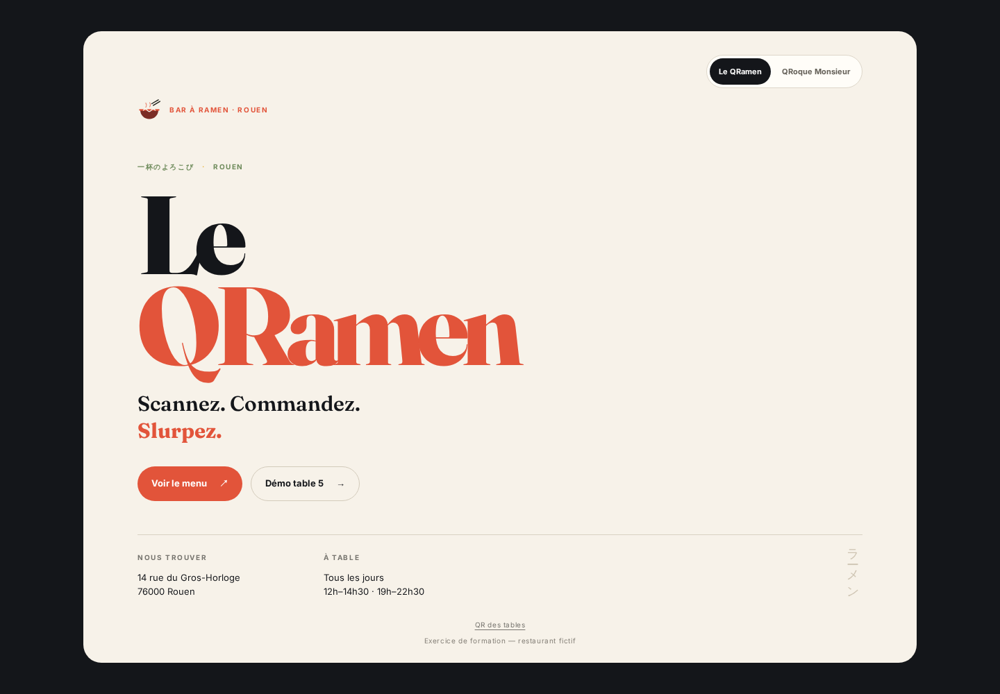
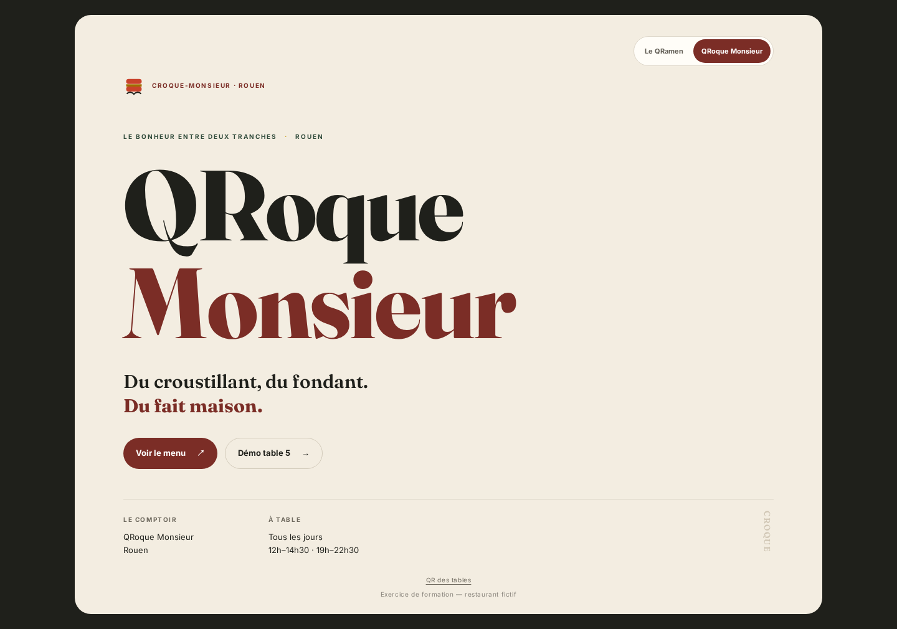
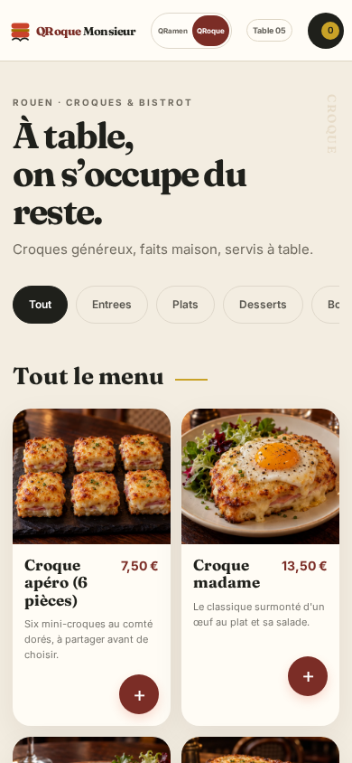

# Commande à table par QR code — deux restaurants de démonstration

Deux restaurants fictifs construits pour un exercice de formation, poussés bien au-delà de la
consigne : le client scanne le QR code de sa table, commande depuis son téléphone, la cuisine voit
le ticket arriver, et le ticket (puis l'addition) part en PDF **tout seul**.

| Restaurant | Concept | En ligne |
| --- | --- | --- |
| **Le QRamen** | bar à ramen, Rouen | <https://qramen.ledeunf.fr/menu.html?table=T05> |
| **QRoque Monsieur** | bistrot du croque, Rouen | <https://croq.ledeunf.fr/menu.html?table=T05> |

Écran cuisine (le même pour les deux) : <https://qramen.ledeunf.fr/cuisine.html>

## Aperçu


La confirmation client affiche le numéro de commande et son suivi en cuisine.


La carte QRamen sur un écran de téléphone, avec ses catégories et ses plats.


Le chevalet QRoque Monsieur au format A6, dans son rendu destiné à l’impression.


La page `/qr.html` permet de générer et d’imprimer les QR codes des tables.


Le tableau cuisine regroupe les commandes en attente, en cours et servies.


La page d’accueil du restaurant Le QRamen.


La page d’accueil du restaurant QRoque Monsieur.


La carte QRoque Monsieur sur téléphone, avec les croques et leurs photos.

**À imprimer**
- Chevalets A5, un QR par table (QRoque Monsieur) : [`public/assets/chevalets-qroque-a5.pdf`](public/assets/chevalets-qroque-a5.pdf)
- Cartes A6, 4 par feuille (QRoque Monsieur) : [`public/assets/cartes-qroque-a6.pdf`](public/assets/cartes-qroque-a6.pdf)
- Carte comptoir A5, sans numéro de table : [`public/assets/carte-comptoir-qroque.pdf`](public/assets/carte-comptoir-qroque.pdf)
- Chevalets Le QRamen : [`public/assets/chevalets-tables.pdf`](public/assets/chevalets-tables.pdf)
- Planche des QR codes des 7 tables : [`docs/qr-tables.pdf`](docs/qr-tables.pdf)

Tous les QR de ces fichiers sont testés : ils se décodent vers la bonne URL (`…/menu.html?table=T01`…`T07`).

## Comment ça marche

```
        scan du QR de la table
Client ───────────────────────► page statique (HTML/CSS/JS, sans framework)
   ▲                                   │
   │                                   ▼
   │                          API n8n auto-hébergée
   │                     /menu /commande /statut /cuisine
   │                                   │
   └────────── Airtable ◄──────────────┘
        (Tables, Plats, Commandes, Lignes)
                     │
                     ▼
        service PDF local (Chrome headless)
        → ticket cuisine + addition, rangés dans Airtable
```

- **n8n** (auto-hébergé, gratuit) porte toute la logique : lecture du menu, création de la commande et
  de ses lignes, suivi du statut, écran cuisine, génération des PDF. Les workflows sont **écrits en
  code** (`outils/workflows.py`) et versionnés ici.
- **Airtable** porte les données : 7 tables, 16 plats, commandes et lignes, avec les pièces jointes
  (ticket, addition) et un statut.
- **Le service PDF** (`outils/pdf-service.py`) transforme un HTML en PDF via Chrome headless ; il est
  protégé par un jeton partagé et n'écoute que pour la machine.
- **Caddy + Cloudflare** servent le domaine `qramen.ledeunf.fr`.

## Deux cartes, un seul moteur

| Carte | Ce qu'elle sert |
|---|---|
| **Le QRamen** | 8 plats asiatiques (ramen tonkotsu, shoyu, végétarien, gyoza, donburi, bao, karaage, mochi) |
| **Le QRoque-Monsieur** | les 8 plats **de l'énoncé** : soupe à l'oignon, salade de chèvre chaud, entrecôte frites, magret, risotto, crème brûlée, fondant, cidre |

Un champ `Concept` dans la base suffit : `GET /menu?concept=QRamen` ou `?concept=QRoque`. Les mêmes
workflows servent les deux restaurants. Tous les visuels de plats ont été générés pour le projet
(16 photos, style reportage, aucun texte incrusté).

## Mockups « en situation »

Le QR incrusté est un **vrai** QR code (il se décode vers la page du menu), pas une illustration.

| Chevalet de table | Vitrine |
| --- | --- |
|  |  |

Scènes complémentaires (QR incrusté + vraie page dans l'écran du téléphone) :

| Comptoir du bar | Terrasse, version brasserie |
| --- | --- |
|  |  |

## Gérer les QR des tables

Depuis l’accueil, le lien discret **QR des tables** ouvre `/qr.html`. La page liste les tables T01 à T07 par défaut et tente de les remplacer par les tables retournées par `/menu`. Elle produit les adresses `menu.html?table=TXX`, permet de télécharger un QR SVG ou PNG et d’imprimer un chevalet A6. Le générateur fonctionne côté navigateur avec la bibliothèque locale `public/assets/vendor/qrcode.js`, sans CDN ni service de QR externe. Les QR ciblent le domaine public propre au restaurant.

Guide détaillé : [mode opératoire restaurateur](docs/mode-operatoire-restaurateur.md).

## Reproduire

```bash
# base Airtable : 4 tables (Tables, Plats, Commandes, Lignes) + champs Concept/Description/Photo
python3 outils/workflows.py            # génère les workflows n8n (dans etat/, non versionné)
bash outils/publier-workflows.sh       # importe, publie et redémarre n8n
bash outils/mettre-en-ligne.sh         # service systemd + site Caddy

# service PDF (jeton dans ~/.hermes/.secrets/qramen-pdf.key, jamais dans le dépôt)
systemctl --user start qramen-pdf
```

## English summary

A fictional ramen bar (Rouen) built for a training exercise, taken far beyond the brief: scan the QR
code on your table, order from your phone, the kitchen board updates live, and the kitchen ticket is
generated as a PDF and attached to the order automatically. Automation runs on self-hosted **n8n**,
data lives in **Airtable**, the pages are plain HTML/CSS/JS, and PDFs are rendered by a small local
service around headless Chrome. A single `Concept` field lets the same engine serve two menus — the
ramen one, and the French brasserie one taken from the exercise brief.

## Licence & sécurité

- Code sous licence [MIT](LICENSE).
- Aucun secret dans le dépôt : le jeton Airtable reste dans n8n, la clé du service PDF dans
  `~/.hermes/.secrets/`. Voir [SECURITY.md](SECURITY.md).
