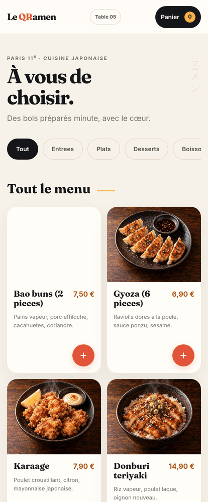
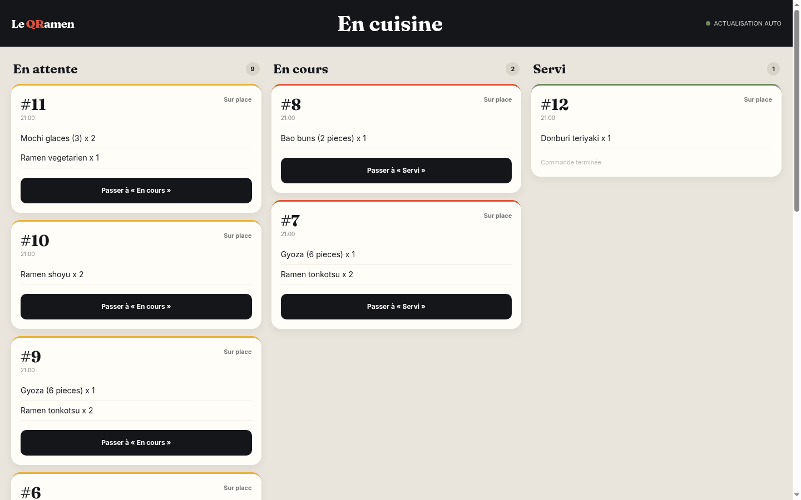

# Le QRamen — commander à table en scannant un QR code

Restaurant fictif (bar à ramen, Paris 11e) construit pour un exercice de formation — poussé bien
au-delà de la consigne : le client scanne le QR code de sa table, commande depuis son téléphone, la
cuisine voit le ticket arriver, et le ticket part en PDF **tout seul**.

**En ligne**
- Menu (mobile) : <https://qramen.ledeunf.fr/menu.html?table=T05>
- Écran cuisine : <https://qramen.ledeunf.fr/cuisine.html>
- Planche des QR codes des 7 tables : [`docs/qr-tables.pdf`](docs/qr-tables.pdf)
- Chevalets de table prêts à imprimer (A4, un QR par table) : [`public/assets/chevalets-tables.pdf`](public/assets/chevalets-tables.pdf)

## Comment ça marche

```
        scan du QR de la table
Client ───────────────────────► page statique (HTML/CSS/JS, sans framework)
   ▲                                   │
   │                                   ▼
   │                          API n8n auto-hébergée
   │                     /menu /commande /statut /cuisine
   │                                   │
   └────────── Airtable ◄──────────────┘
        (Tables, Plats, Commandes, Lignes)
                     │
                     ▼
        service PDF local (Chrome headless)
        → ticket cuisine + addition, rangés dans Airtable
```

- **n8n** (auto-hébergé, gratuit) porte toute la logique : lecture du menu, création de la commande et
  de ses lignes, suivi du statut, écran cuisine, génération des PDF. Les workflows sont **écrits en
  code** (`outils/workflows.py`) et versionnés ici.
- **Airtable** porte les données : 7 tables, 16 plats, commandes et lignes, avec les pièces jointes
  (ticket, addition) et un statut.
- **Le service PDF** (`outils/pdf-service.py`) transforme un HTML en PDF via Chrome headless ; il est
  protégé par un jeton partagé et n'écoute que pour la machine.
- **Caddy + Cloudflare** servent le domaine `qramen.ledeunf.fr`.

## Deux cartes, un seul moteur

| Carte | Ce qu'elle sert |
|---|---|
| **Le QRamen** | 8 plats asiatiques (ramen tonkotsu, shoyu, végétarien, gyoza, donburi, bao, karaage, mochi) |
| **Le QRoque-Monsieur** | les 8 plats **de l'énoncé** : soupe à l'oignon, salade de chèvre chaud, entrecôte frites, magret, risotto, crème brûlée, fondant, cidre |

Un champ `Concept` dans la base suffit : `GET /menu?concept=QRamen` ou `?concept=QRoque`. Les mêmes
workflows servent les deux restaurants. Tous les visuels de plats ont été générés pour le projet
(16 photos, style reportage, aucun texte incrusté).

## Captures

| Menu (téléphone) | Écran cuisine |
|---|---|
|  |  |

## Mockups « en situation »

Le QR incrusté est un **vrai** QR code (il se décode vers la page du menu), pas une illustration.

| Chevalet de table | Vitrine |
| --- | --- |
|  |  |

## Reproduire

```bash
# base Airtable : 4 tables (Tables, Plats, Commandes, Lignes) + champs Concept/Description/Photo
python3 outils/workflows.py            # génère les workflows n8n (dans etat/, non versionné)
bash outils/publier-workflows.sh       # importe, publie et redémarre n8n
bash outils/mettre-en-ligne.sh         # service systemd + site Caddy

# service PDF (jeton dans ~/.hermes/.secrets/qramen-pdf.key, jamais dans le dépôt)
systemctl --user start qramen-pdf
```

## English summary

A fictional ramen bar (Paris) built for a training exercise, taken far beyond the brief: scan the QR
code on your table, order from your phone, the kitchen board updates live, and the kitchen ticket is
generated as a PDF and attached to the order automatically. Automation runs on self-hosted **n8n**,
data lives in **Airtable**, the pages are plain HTML/CSS/JS, and PDFs are rendered by a small local
service around headless Chrome. A single `Concept` field lets the same engine serve two menus — the
ramen one, and the French brasserie one taken from the exercise brief.

## Licence & sécurité

- Code sous licence [MIT](LICENSE).
- Aucun secret dans le dépôt : le jeton Airtable reste dans n8n, la clé du service PDF dans
  `~/.hermes/.secrets/`. Voir [SECURITY.md](SECURITY.md).
